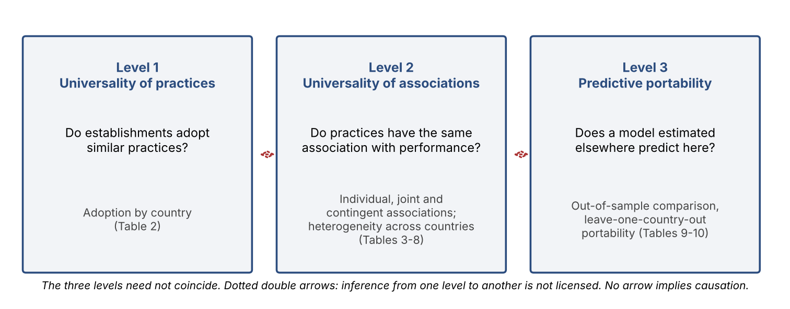
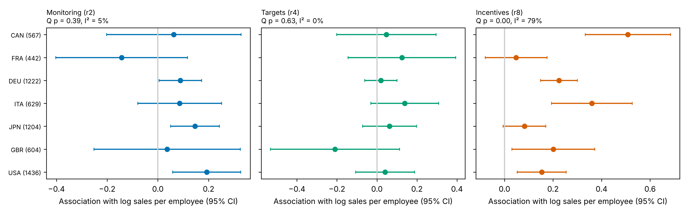
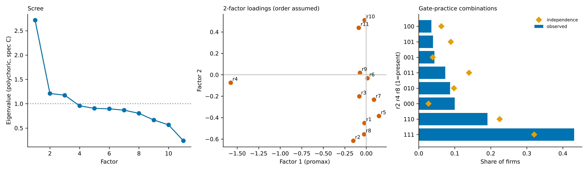

**Keywords:** national culture; Hofstede; management-control practices; monitoring, targets and incentives; predictive portability; heterogeneity across countries; out-of-sample validation; World Bank Enterprise Surveys

# 1. Introduction

Structured management practices — monitoring performance, setting targets and linking rewards to them — are among the most widely studied correlates of firm productivity (Bloom & Van Reenen, 2007) and have been described as a transferable managerial technology (Bloom, Sadun & Van Reenen, 2016). Evidence from a field experiment in Indian textile firms indicates that adopting such practices can be followed by productivity gains (Bloom et al., 2013). If practices behave like a technology, models of their association with performance estimated in one country should carry over to others, and policy or managerial advice based on them should travel. Yet the same literature documents wide variation in the adoption of practices across firms and countries (Bloom et al., 2012; Scur et al., 2021), and work on the international transfer of organisational practices stresses that formal adoption is not the same as institutionalisation in the receiving unit (Kostova, 1999; Kostova & Roth, 2002).

This article argues that three notions are routinely run together under the heading of universality. The first is universality of practices: whether establishments in different countries adopt similar practices. The second is universality of associations: whether those practices have the same association with performance. The third is predictive portability: whether a model estimated in one context predicts outcomes in another. The three need not coincide. Practices can be adopted unevenly while associated with performance in a similar way; associations can differ across countries while a common model predicts almost as well as country-specific ones, because the share of variance that practices explain is small relative to the cost of estimating additional slopes (Figure 1).

{width=6.4in}

Differences between countries are often attributed to national culture. Hofstede's dimensions (1980, 2001) offer a way to formulate expectations: acceptance of hierarchy and avoidance of uncertainty may shape how monitoring and targets are used, and individualism and masculinity how rewards are received. These are theoretical expectations, not established effects, and national scores are not measures of the culture of the establishments surveyed. With seven countries, culture can be examined only exploratorily. The article therefore asks three questions: (RQ1) whether cultural dimensions are associated with the adoption of control practices; (RQ2) whether they help interpret the heterogeneity of practice–performance associations; and (RQ3) whether cultural information could improve the predictive portability of models, a question we can bound but not fully answer with the present data.

We examine the three notions with World Bank Enterprise Surveys (WBES) for seven G7 economies in 2024–2025 (6,316 establishments in the management-practices module, mostly with 20 or more employees), using three observable practices: monitoring, targets and target-linked bonuses. Adoption differs markedly across countries (for example, target-linked bonuses range from 36% of establishments in Italy to 76% in the United Kingdom). Incentives and monitoring are associated with higher productivity (about 22% and 13% respectively), targets are not, and no joint effects or reliable organisational contingencies are found. The association of incentives ranges from about 66% in Canada to about 5% in France; this heterogeneity does not depend on outliers or on any single country but is not statistically significant after Holm correction under wild cluster bootstrap inference and weakens with sampling weights. Despite it, a common model of the three practices is not detectably improved on out of sample by country-specific or contingent slopes, and a model estimated on the other six countries ports close to a local one. The comparisons have limited power and we do not claim equivalence.

The article makes two contributions. First, it separates universality of practices, of associations and of predictive models, and shows empirically that the three can diverge: heterogeneity of associations does not by itself imply that country-specific models predict better. Second, it quantifies why, by comparing the gain that exactly known country slopes would offer with the cost of estimating them, and by showing that partial pooling lies between the extremes. The contribution is a clarification of what heterogeneity tests and predictive tests can and cannot answer, not a new method. Secondary contributions concern national culture, for which we state what seven countries can and cannot support, and management control: reading monitoring, targets and incentives as observable cybernetic, results and reward mechanisms (Malmi & Brown, 2008), we state precisely what presence-based data can say about them and what requires information on integration and use that the surveys do not contain.

The evidence is cross-sectional and concerns reported practices measured by single binary items whose wording could only be partly verified. Associations are conditional on sector-by-country effects, size and age and are not causal. Predictive portability is not organisational transfer: a model that predicts well in another country does not show that implementing the same practices there would produce the same performance.

# 2. Theoretical framework

Bibliographic records were checked against publisher, repository or database records; full texts were not consulted, so statements are limited to what abstracts and records state.

## 2.1 Management as a technology

Bloom and Van Reenen (2007) measure practices of monitoring, target setting and incentives and relate them to productivity; later work reviews why practices differ across firms and countries (Bloom & Van Reenen, 2010) and asks whether management is better seen as a technology than as a contingent style (Bloom, Sadun & Van Reenen, 2016). Bloom, Genakos, Sadun and Van Reenen (2012) document wide variation in practices across firms and countries, Bloom et al. (2013) report a randomised field experiment in Indian textile firms in which adopting management practices was followed by productivity gains, and Scur et al. (2021) review what the World Management Survey has taught about measurement. The technology reading yields three expectations, one for each level of this article: similar adoption, a common association with performance, and models that carry over. Because the literature itself documents variation in adoption, the first expectation is the weakest; the second and third are the benchmark against which heterogeneity is defined here.

## 2.2 National culture as a contextual explanation

Hofstede (1980, 2001) characterises national cultures by dimensions, of which four are relevant to the three practices. Power distance (PDI), the acceptance of unequal power, may shape the acceptability of monitoring and of targets set from above; uncertainty avoidance (UAI), the preference for rules and procedures, may favour monitoring and targets; individualism (IDV) and masculinity (MAS), the emphasis on individual achievement and competition, may make individual rewards more or less effective (Table C1). These links are hypotheses to examine, not effects established here. They face three objections that the design must respect. National scores are not measures of the values of the employees or managers of the establishments surveyed, and moving from national scores to explanations of organisational behaviour has been criticised (McSweeney, 2002); differences between countries may also reflect labour regulation, sector structure, pay practices or questionnaire wording rather than culture (Harrison & McKinnon, 1999); and with seven countries each dimension takes only seven values.

**Table C1.** Hofstede dimensions, expected mechanism and practice concerned (theoretical expectations, not tested effects).

| Dimension | Expected mechanism | Practice concerned |
|:--|:--|:--|
| Power distance (PDI) | Acceptance of hierarchy and of control exercised by superiors | Monitoring, targets |
| Individualism (IDV) | Importance of autonomy and individual rewards | Incentives |
| Uncertainty avoidance (UAI) | Preference for rules, procedures and reduced uncertainty | Monitoring, targets |
| Masculinity (MAS) | Valuation of competition, achievement and rewards | Incentives |

## 2.3 From transfer to institutionalisation

Work on the international transfer of organisational practices holds that success depends on institutionalisation at the receiving unit, on the institutional profile of the country and on organisational context (Kostova, 1999), and that adoption can be ceremonial (Kostova & Roth, 2002). Earlier institutional theory shows that formal practices may be adopted for legitimacy and decoupled from operations (Meyer & Rowan, 1977). These frameworks were developed for transfers within multinational corporations; they are used here only to explain why formal adoption need not imply the same association with performance, and are not tested. The data contain country identifiers only, which are not measures of institutions or culture; culture enters only through the exploratory comparison of Section 6.9. Culture, institutionalisation and control mechanisms are linked in the framework of this article as: national culture, adoption and institutionalisation of practices, associations with performance, and implications for management control. Institutionalisation is not measured by WBES and is proposed as a mechanism, not tested. To keep the vocabulary precise, "transfer" is reserved for the implantation of a practice in an organisation, and "portability" designates the out-of-sample performance of a statistical model estimated elsewhere.

## 2.4 Implications for control mechanisms

Monitoring corresponds to cybernetic and diagnostic control (measuring and tracking results), targets to planning and results control (setting objectives and orienting behaviour), and incentives to reward control (aligning effort and rewards); the categories follow Malmi and Brown (2008) and, for results controls, Merchant and Van der Stede (2017). Malmi and Brown argue that controls should be studied as a package, and Grabner and Moers (2013) distinguish a package from a system with internal consistency. The correspondence is interpretive. The three practices are not a complete control system: belief and boundary systems, interactive use, administrative and cultural controls, and internal consistency are not observed, so the study concerns observable management-control practices, measured by presence. Interactions among practices are treated as statistical interactions; complementarity in the sense of supermodularity (Milgrom & Roberts, 1995) is stronger, and cross-sectional tests of complementarity can be biased (Athey & Stern, 1998). The organisational contingencies observable in WBES — size, age, ownership, exports and manager characteristics — allow only a partial test of the contingency literature on control (Chenhall, 2003; Otley, 2016).

# 3. Research questions and hypotheses

**Central question.** To what extent does national culture explain cross-country differences in the adoption and performance associations of management-control practices, and can cultural information improve the portability of models? Because the answer first requires establishing whether monitoring, target setting and incentives show the same adoption, associations and portability across seven advanced economies, the empirical work is organised by the three levels below.

Hypotheses are formulated after an earlier exploratory phase on the same data and are not pre-registered. The partial-pooling model (HB) and the robustness checks of Section 6.4 were added after that phase.

- **Level 1 — universality of practices.** **H1.** Adoption of monitoring, targets and incentive-linked bonuses differs across countries (descriptive; not interpreted as an institutional effect).
- **Level 2 — universality of associations.** **H2a.** Each practice is positively associated with productivity. **H2b.** The association of each practice differs across countries. **H2c.** Practices are associated with productivity jointly and contingently, beyond their individual associations.
- **Level 3 — predictive portability.** **H3a.** A common-slope model is not predictively inferior to country-specific slopes, despite heterogeneity in H2b, because the explained variance is small relative to the cost of estimating additional slopes. **H3b.** Models estimated in a single country port less well than models estimated on several countries. **H3c.** A partial-pooling model performs at least as well as the two extremes.
- **Cultural expectations (exploratory; seven countries).** **HC1.** Adoption of monitoring and targets is positively related to PDI and UAI, and adoption of incentives to IDV and MAS. **HC2.** The cross-country association of incentives with productivity is positively related to IDV and MAS. **HC3.** A model that includes cultural information improves out-of-sample prediction over the common model.
- **Boundary statement.** Predictive portability is not organisational transfer: a model that predicts well in another country does not show that implementing the same practices there would produce the same performance.

A model with practice × cultural-dimension interactions (MCS × Z_c) cannot be estimated reliably with seven countries, since each dimension has seven values; it is nested in the national-slope model N1, which therefore bounds what any cultural moderation could add. Cultural hypotheses are examined by rank correlations at country level and are not confirmatory.

# 4. Data and measurement

**Sample.** The merged WBES file contains 10,968 establishments from Canada (2024), France (2025), Germany (2025), Italy (2024), Japan (2025), the United Kingdom (2024) and the United States (2024). The original country files with value labels were not available. The management-practices module is asked of 6,316 establishments (88.5% with 20 or more permanent full-time employees); the others are outside the module's universe (Table 2).

**Practices.** Monitoring is whether the establishment tracked production or service performance indicators (r2, yes = 1); Targets is whether it had production or service targets (r4); Incentives is whether bonuses were tied to production or service targets (r8). Their direction (yes = 1) is verified by the skip logic of the data (follow-up items are asked only after a yes). Table 1 gives the correspondence between items, their use in the analysis and the verification status of their wording. Only r2, r4 and r8 enter the main models; r3 defines a monitoring-breadth variant; r1 and r9 are partly verified, r6 and r7 are unverified, and r10 and r11 (unverified) enter only the complementary latent analyses of Appendix B, with a sensitivity analysis that excludes them.

**Table 1.** Correspondence of questionnaire items, use in the analysis and verification of wording.

| Item | Use | Content (our paraphrase) | Original wording | Status |
|:--|:--|:--|:--|:--|
| r2 | Monitoring (main) | Tracked production or service performance indicators | [to be inserted from questionnaire] | Partly verified (secondary descriptions) |
| r3 | Breadth variant | Number of indicators (asked only if r2 = yes) | [to be inserted] | Partly verified |
| r4 | Targets (main) | Had production or service targets | [to be inserted] | Inferred from r5 |
| r5 | Not used (supports r4) | Time frame of targets (asked only if r4 = yes) | [to be inserted] | Label verified for Italy 2024 |
| r8 | Incentives (main) | Bonuses tied to production or service targets | [to be inserted] | Partly verified (secondary descriptions) |

**Structure among the practices.** Item r8 is asked of all establishments, not only of those with targets, but it is related to r4: 64.5% of establishments with targets report target-linked bonuses against 38.1% of those without, and 14% of establishments reporting such bonuses (35% in Germany) report no targets. The correlations are moderate (φ = 0.41 for monitoring and targets, 0.22 for targets and incentives, 0.27 for monitoring and incentives), and variance inflation factors after controls are 1.05 to 1.21, so the three coefficients are separately estimable. Bonuses linked to targets without reported targets suggests that respondents may interpret the two items differently, which weakens inference on the interaction of targets and incentives.

**Measurement invariance.** The practices are single binary indicators. A measurement model with latent factors, and hence a test of invariance of loadings or thresholds across countries, cannot be identified from three binary items, so differences in reporting across countries cannot be tested directly. We instead check the coherence of country profiles against the skip logic and the relation between r4 and r8. The profile of Japan (87% with targets, 47% monitoring indicators) is atypical and may reflect differences in the understanding or translation of items rather than in practice; its influence is bounded by the leave-one-country-out analysis (Section 6.4).

**Outcomes and controls.** Outcomes are log sales per employee, annualised three-year sales growth and annualised three-year employment growth (the definitions of the base-year variables are assumed, not verified). Sales per employee is winsorised at the 0.5th and 99.5th percentiles within country, and the growth outcomes at the 1st and 99th percentiles of the pooled sample; results for productivity are insensitive to no winsorisation, to 5/95 winsorisation and to median regression (Section 6.4). Sales are in local currency, so levels are compared only within country. Growth over three years is observed only for establishments that survived, and reverse causality (growing firms adopting incentives) cannot be excluded. Controls are log employment, log age and sector fixed effects (sector codes are country-specific, so sector-by-country effects absorb country levels). Organisational moderators are foreign ownership of at least 10% (b2b), exporter status (d3b, d3c), top-manager experience (b7) and female top manager (b7a); their labels were checked only against data-dictionary records of other 2024 surveys.

**Survey design.** Sampling weights exist but the module universe is a subset of the sampled establishments, and stratum and cluster identifiers are not in the file. Establishments are sampled within strata (including sector), so sector is a stratum rather than necessarily a cluster; main analyses are unweighted with HC3 errors, and sector-by-country clustering is used as a conservative sensitivity analysis (73 clusters, 7 to 15 per country). Weighted analyses are reported as robustness checks.

# 5. Empirical strategy

The strategy is organised by level.

## 5.1 Level 1: adoption

Adoption is described by country as the share of valid responses reporting each practice, with the mean core score (number of practices present among r2, r4, r8; 0–3) and median size (Table 2). No inferential test is attached: differences are confounded by size composition.

## 5.2 Level 2: associations

**Individual associations.** Performance_ic = α_s(i) + β_M·M_ic + β_T·T_ic + β_I·I_ic + γ′X_ic + ε_ic, where s(i) is the sector-by-country fixed effect and X contains log size and log age (HC3 standard errors); the three practices enter together so that coefficients are partial associations. No causal interpretation is made.

**Combinations.** The specification adds M×T, M×I and T×I (and a three-way term), tested jointly and individually, with Holm correction within the family. A statistical interaction is not complementarity in the strong sense.

**Heterogeneity across countries.** Country-specific coefficients are estimated separately by country and, in a pooled model, by interacting each practice with country (with country-specific control slopes). Equality of each practice's coefficients across the seven countries is tested with robust Wald statistics (6 df) using HC3 errors and a restricted wild cluster bootstrap with Rademacher weights and clusters defined as country-by-sector cells (Cameron, Gelbach & Miller, 2008; 999 replicates; 73 clusters), because asymptotic clustered tests are unreliable with 7 to 15 clusters per country. Heterogeneity is summarised with Cochran's Q and I² (Higgins & Thompson, 2002) and a random-effects mean, with Q-profile confidence intervals for τ and I², leave-one-country-out analyses, weighted estimates (WLS with the supplied weights), alternative winsorisation of the outcome and median regression. Holm's correction (Holm, 1979) is applied across the nine practice-by-outcome tests. Organisational moderators are tested by interacting the three practices with each moderator (joint 3 df) with Holm correction over 18 tests.

## 5.3 Cultural reading (exploratory)

Hofstede scores are the published national scores of Hofstede (2001) as reproduced on the Hofstede Insights country-comparison site [verify scores and date against the database used]. Country-level adoption rates (Table 2) and country-specific incentives coefficients (Table 5) are related to the relevant dimensions by Spearman rank correlations, with leave-one-country-out ranges. No p-values are reported, because seven observations cannot support them; results are descriptive and are presented to show how fragile a cultural reading would be. A meta-regression of the country coefficients on a dimension, weighted by their sampling variances, is [TO COMPLETE: to be estimated and reported with confidence intervals, in the case of incentives only].

## 5.4 Level 3: predictive portability

**Out-of-sample comparison.** Models are compared by 10-fold cross-validation repeated three times, with folds stratified by country and identical across models. Every model carries the same controls and main effects of the moderators, so that differences isolate the practice terms: U0 (controls only), P1 (common slopes for M, T, I), P2 (P1 plus combinations), C1 (P1 plus practices × organisational moderators), N1 (national-slope model: country-specific slopes for each practice) and X (C1 plus country-specific slopes). HB is a partial-pooling model in which country-specific slopes are shrunk toward the pooled slope with penalties derived from the heterogeneity estimated in each training fold (an empirical-Bayes random-slope predictor). N1 bounds any model with a national institutional interaction. Paired differences in squared error are reported with a firm-level interval, which ignores dependence across folds, and with the corrected resampled interval of Nadeau and Bengio (2003) computed on fold-level errors. Absence of a detectable gain is not treated as equivalence: the corrected intervals are compared with the oracle gain (below) and no equivalence margin is claimed.

**Portability across countries.** Portability is assessed on country-by-sector-demeaned data: a model estimated on one source country, or on the other six countries (LOCO), is applied to each target and compared with a model estimated and cross-validated in the target (local), and with a global pooled model that adds the target's training folds; paired bootstrap intervals are reported for the differences, and the seven target-specific differences between local and LOCO models are combined by inverse-variance weighting. The LOCO models for different targets share most of their training data, so the seven differences are not independent and the combined interval is approximate. To separate the practices from the controls, the analysis is repeated with the control coefficients held fixed at the target's LOCO estimates (practice-only transfer of coefficients, hereafter "practice-only portability").

**Why a common model can stay competitive.** The oracle gain of knowing country slopes exactly (the estimated slope heterogeneity multiplied by the residual variance of each practice) is compared with the out-of-sample cost of estimating the additional slopes, and the out-of-sample power of national slopes is simulated at the estimated heterogeneity and at multiples of it.

# 6. Results

## 6.1 Level 1: adoption of practices (Table 2)

The module universe contains 6,316 establishments. Reported use of monitoring ranges from 47% in Japan to 92% in the United Kingdom, targets from 60% in Italy to 93% in the United Kingdom, and target-linked bonuses from 36% in Italy to 76% in the United Kingdom. The mean core score ranges from 1.51 in Italy to 2.61 in the United Kingdom. These descriptive differences are confounded by size composition (median employees from 40 in Canada to 98 in the United Kingdom) and by the unverified measurement of items, and are not evidence of institutional or cultural effects. H1 is supported descriptively.

**Table 2.** Management-module universe by country: sample size, median permanent full-time employees, share reporting each practice among valid responses, and mean core score (number of practices present among r2, r4, r8; 0–3).

@@T:109-125@@

## 6.2 Level 2: individual associations (Table 3)

With the three practices entered together, incentives show the strongest association with productivity (0.199 log points, 95% CI 0.156 to 0.243, about 22% higher sales per employee), followed by monitoring (0.122; 0.069 to 0.175; about 13%); targets are not distinguishable from zero (0.047; −0.010 to 0.104), so the expectation that each practice is positively associated with productivity (H2a) is supported for monitoring and incentives but not for targets. For sales growth, targets (0.0077) and incentives (0.0064) are positively associated and monitoring is not; for employment growth only incentives are (0.0079; 0.0044 to 0.0113). Using the breadth of monitoring (three bands of r3) instead of its presence, each band is associated with 0.085 log points of productivity (0.063 to 0.107), and the association of targets falls to 0.019. These are conditional associations within sector-by-country cells; they do not show that adopting a practice raises performance.

**Table 3.** Individual associations of monitoring, targets and incentives with performance (pooled; practices entered together; sector-by-country fixed effects, log size, log age; HC3): coefficient [95% CI]. Productivity = log sales per employee; growth outcomes are annualised three-year log changes.

@@T:131-143@@

## 6.3 Level 2: combinations (Table 4)

No pairwise interaction is distinguishable from zero for productivity or sales growth, and the joint pairwise test is not significant for any outcome (p = 0.35, 0.94, 0.14). The three-way interaction is positive for productivity (0.229; 0.010 to 0.448; p = 0.040) but is absent for the growth outcomes (p = 0.99, 0.84) and does not survive correction for the three outcomes tested. Given the partial overlap of the targets and incentives items (Section 4), the data provide no evidence that the practices operate jointly beyond their individual associations (H2c, first part, not supported).

**Table 4.** Combinations of practices: statistical interactions (coefficient [95% CI], p) and joint pairwise test.

@@T:149-161@@

## 6.4 Level 2: stability across countries (Tables 5 to 7, Figure 2)

For productivity, the estimated association of incentives varies from 0.509 in Canada (0.333 to 0.684; about 66%) to 0.048 in France (−0.079 to 0.175; about 5%), with 0.360 in Italy, 0.225 in Germany, 0.202 in the United Kingdom, 0.154 in the United States and 0.082 in Japan (−0.006 to 0.171); Cochran's Q = 28.4 (df = 6, p = 0.0001), I² = 79% (95% CI 58% to 97%), τ = 0.114 (95% CI 0.070 to 0.346). The association of monitoring is positive in the United States (0.193), Japan (0.146) and Germany (0.089) and not distinguishable from zero in the other four countries, and that of targets in none; equality across countries is not rejected for either (p = 0.39 and 0.63 with HC3 errors). Descriptively, the productivity association is concentrated in incentives in Canada and Italy and is of similar size for monitoring and incentives in the United States and Japan, but differences between practice coefficients within a country were not tested.

**Table 5.** Country-specific associations of each practice with productivity (separate regressions by country; coefficient [95% CI]); heterogeneity across countries (Cochran's Q, I²) and random-effects mean.

@@T:167-187@@

{width=6.6in}

**Table 6.** Tests of equality of each practice's coefficients across the seven countries (robust Wald, 6 df): HC3 p (Holm-adjusted over the nine practice-by-outcome tests) and restricted wild cluster bootstrap p (999 replicates; clusters = country-by-sector cells, 73 clusters; Holm-adjusted over the nine tests).

@@T:195-205@@

**Table 7.** Robustness of the heterogeneity of the incentives–productivity association across countries: Cochran's Q, p, I² and τ (95% Q-profile intervals for the main specification).

@@T:209-225@@

The evidence for heterogeneity in the incentives–productivity association is moderate and depends on inference (Table 7). It is unchanged by leaving out any single country (p from 0.0000 to 0.013; I² from 65% to 82%; without Canada Q = 14.5, I² = 65%), by not winsorising the outcome, by 5/95 winsorisation and by median regression (I² 77% to 81%), so outliers do not drive it. It is weaker with the supplied weights (Q = 11.0, p = 0.088, I² = 45%) and with the restricted wild cluster bootstrap, where the p-value for incentives and productivity is 0.015 (73 clusters, 7 to 15 per country) and 0.105 after Holm correction over the nine tests; asymptotic clustered p-values are anti-conservative with so few clusters and are not reported. [TO COMPLETE: effect of the weights on the country-specific incentives coefficients for Canada and Italy, the two countries at the top of the range.]

Outside productivity, the clearest signals of heterogeneity concern targets. For sales growth the wild bootstrap p-value is 0.006 (Holm 0.054; HC3 p = 0.0027), for employment growth 0.012 (Holm 0.096), and the joint test over the three practices for employment growth is p = 0.033 under the bootstrap. No test is significant at the 5% level after Holm correction under the bootstrap. These signals are not interpreted: growth outcomes condition on survival, the targets item is inferred from its follow-up item, and it overlaps with the incentives item (Section 4). They do not appear in the productivity analysis, where heterogeneity of targets is not detected (I² = 0%), and the growth outcomes show no predictive signal (Section 6.6).

Heterogeneity in incentives is therefore large in magnitude, robust to outliers and to the exclusion of any country, but statistically fragile under weighting and clustered inference. The expectation that associations differ across countries (H2b) is suggestively supported for incentives and productivity only.

## 6.5 Level 2: organisational contingencies (Table 8)

Among the six organisational moderators, only size shows a joint interaction with the practices for productivity (Wald χ² = 11.5, p = 0.009), which does not survive correction over the 18 tests (Holm p = 0.17); foreign ownership (p = 0.048; Holm 0.71) and the other moderators show no reliable moderation, and none is significant for growth after correction. H2c (contingent part) is not supported. [TO COMPLETE: incentives × size by country, to establish whether the size interaction and the cross-country variation of incentives, can be separated.]

**Table 8.** Organisational moderators of the practice–productivity associations: joint test of the three practice-by-moderator interactions (3 df) and Holm-adjusted p over the 18 tests (three outcomes × six moderators).

@@T:233-247@@

## 6.6 Level 3: out-of-sample comparison (Table 9)

For productivity, common slopes for the three practices (P1) lower out-of-sample RMSE from 0.7924 to 0.7854, a 1.8% reduction in mean squared error (corrected 95% CI 0.0055 to 0.0167 in squared log points; p < 0.001). Adding combinations (−0.0002), organisational contingency (−0.0010) or national slopes for each practice (N1; 0.0002; corrected CI −0.0031 to 0.0035; p = 0.91) brings no detectable gain. The partial-pooling model (HB) has the lowest RMSE (0.7845), 0.0014 below P1 (corrected CI −0.0003 to 0.0031; p = 0.11) and 0.0012 below N1 (−0.0009 to 0.0033; p = 0.25): the best point estimate, but not reliably different from either (H3a, H3c). For growth outcomes no model improves on the controls by more than 0.25%. These results show that the comparison could not detect gains, not that gains are absent: the corrected interval for N1 against P1 includes both zero and the oracle gain of 0.0028 described below, and equivalence is not established.

**Table 9.** Out-of-sample comparison (10-fold cross-validation × 3, folds stratified by country and identical across models): RMSE for productivity, incremental R² over controls, RMSE for growth outcomes; lower panel: paired reductions in mean squared error for productivity (squared log points) with firm-level 95% CI and corrected resampled 95% CI (Nadeau–Bengio).

@@T:253-269@@

@@T:271-287@@

## 6.7 Level 3: why does a common model remain competitive?

Heterogeneity that is large in magnitude is small in predictive terms because the practices explain little variance. If country-specific slopes were known exactly, the mean squared error would fall by 0.0028 (0.45% of the residual variance), almost entirely through incentives, whereas estimating eighteen additional slopes costs about 0.0021 out of sample; the expected net gain is 0.0008. In simulations at the estimated heterogeneity, national slopes beat the common model in only 53% of replications (mean gain 0.0007); at twice the estimated heterogeneity they do in 95%. With seven countries and R² of about 2%, an out-of-sample comparison therefore has roughly even power at the estimated heterogeneity, and shrinkage (HB), which sits between the two extremes, gives the best point estimate. The competitiveness of the common model reflects the small share of variance explained and the cost of estimating country-specific slopes; it does not show that associations are homogeneous.

## 6.8 Level 3: portability across countries (Table 10)

Out-of-sample R² for productivity is small in every country (local models: −0.02 to 0.08). A model estimated in a single country is worse than the local model in 93% of the 42 source–target pairs, by 0.033 R² units on average, with large losses for some pairs (Canada and Italy as sources for France: −0.118 and −0.111), in line with H3b. Holding the control coefficients fixed at the target's LOCO estimates so that only the practice coefficients are ported, the local model is better in 81% of pairs with a mean advantage of 0.017, and the loss for Canada to France remains (−0.113); about half of the loss in the full model therefore comes from the control coefficients and composition, and the rest from the practice coefficients. A model estimated on the other six countries (LOCO) performs close to the local model but not identically: local minus LOCO is positive in six of seven countries (0.001 to 0.022), each interval includes zero, and the inverse-variance combined difference is 0.0095 R² units (95% CI 0.0023 to 0.0167; p = 0.010), a small but detectable advantage of local estimation, to be read with the dependence among LOCO targets noted in Section 5.4. For practice-only portability the local-minus-LOCO differences are close to zero (−0.005 to 0.015; every interval includes zero). [TO COMPLETE: combined local − LOCO difference for practice-only portability, with 95% CI, using the same inverse-variance procedure.] Growth outcomes show no portable signal.

**Table 10.** Predictive portability of the three-practice model for productivity: out-of-sample R² of a model estimated in the source country (rows) applied to the target (columns); LOCO = estimated on the other six countries; Local = estimated and cross-validated in the target; last row: local minus LOCO with paired bootstrap 95% CI.

@@T:295-317@@

## 6.9 Exploratory cultural reading (Table C2)

*Adoption (HC1).* Across the seven countries, the adoption of target-linked bonuses is positively rank-related to individualism (ρ = 0.64; leave-one-out range 0.43 to 0.77), as expected, and not related to masculinity (ρ = −0.20; −0.64 to 0.17). The adoption of monitoring is negatively rank-related to uncertainty avoidance (ρ = −0.64; −1.00 to −0.43), the opposite of the expectation, and weakly to power distance (−0.25); targets show no clear relation (ρ = 0.11 with PDI, −0.13 with UAI). Adoption rates are confounded by size composition (Section 6.1), and these figures are not tests.

*Associations (HC2).* The incentives coefficients are not related to individualism (ρ = 0.25; leave-one-out range −0.09 to 0.43) or masculinity (ρ = 0.09; −0.46 to 0.41); the highest-masculinity country, Japan (MAS = 95), has one of the lowest coefficients (0.082), and Canada (IDV = 80), with the highest coefficient (0.509), is not the most individualist country (United States, IDV = 91, 0.154). The only moderate relation concerns power distance (ρ = −0.59; −0.81 to −0.35), and uncertainty avoidance to a lesser degree (ρ = −0.39; −0.54 to −0.09): countries with lower power distance show larger incentives coefficients. This relation was not hypothesised for incentives and rests on seven points, among which France (PDI = 68, coefficient 0.048) weighs heavily. For monitoring and targets, rank correlations between coefficients and PDI or UAI are not interpretable: the coefficients are statistically homogeneous across countries (I² = 5% and 0%, Table 5), so their ordering reflects estimation noise (for example ρ = 0.85 between targets and PDI). HC2 is not supported, and a simple reading in which cultures that value competition or individual rewards show stronger incentive–performance associations is not borne out.

*Prediction (HC3).* The national-slope model N1 contains any model with a cultural moderator, and N1 is not detectably better than the common model P1 (Section 6.6); the oracle gain of 0.0028 therefore also bounds what cultural information could add through slopes. [TO COMPLETE: out-of-sample comparison of a cultural model (practice × one dimension) against P1, N1 and HB, folds identical to Table 9.]

**Table C2.** Hofstede scores (published national scores), incentives–productivity coefficient (Table 5) and adoption of target-linked bonuses (Table 2), by country.

| Country | PDI | IDV | MAS | UAI | Incentives coefficient | Bonuses (%) |
|:--|--:|--:|--:|--:|--:|--:|
| Canada | 39 | 80 | 52 | 48 | 0.509 | 63 |
| Italy | 50 | 76 | 70 | 75 | 0.360 | 36 |
| Germany | 35 | 67 | 66 | 65 | 0.225 | 59 |
| United Kingdom | 35 | 89 | 66 | 35 | 0.202 | 76 |
| United States | 40 | 91 | 62 | 46 | 0.154 | 67 |
| Japan | 54 | 46 | 95 | 92 | 0.082 | 54 |
| France | 68 | 71 | 43 | 86 | 0.048 | 48 |

# 7. Discussion

## 7.1 What is universal, what is heterogeneous, what is portable

The three levels give different answers (Table 11). Adoption is clearly heterogeneous. Associations with productivity are common in sign for incentives and monitoring and absent for targets; the association of incentives varies strongly across countries, but this variation is statistically fragile; no joint effects and no reliable contingencies were found. Predictively, a common model of the three practices is not detectably improved on by national or contingent slopes, partial pooling gives the best point estimate, and a model estimated on the other six countries is close to, but slightly worse than, a local one. The common model remains the predictive benchmark, but the comparison has limited power and cannot establish equivalence. The error the article documents is the inference from one level to another: heterogeneity at Level 2 does not entail a predictive loss at Level 3, and good portability at Level 3 does not entail homogeneous associations at Level 2.

**Table 11.** Summary by level of universality (all figures from Tables 2 to 10).

| | Level 1: adoption | Level 2: association with productivity | Level 3: predictive portability |
|:--|:--|:--|:--|
| Monitoring | 47–92% across countries | Positive (0.122); no heterogeneity detected (I² = 5%) | Model-level (below) |
| Targets | 60–93% | Not distinguishable from zero (0.047); no heterogeneity detected in productivity (I² = 0%) | Model-level (below) |
| Incentives | 36–76% | Strongest (0.199); 0.05 to 0.51 across countries (I² = 79%), fragile under weights and wild bootstrap | Model-level (below) |
| Combinations and contingencies | — | No joint effects; no reliable contingencies | No gain over P1 (P2, C1) |
| Common model (P1) vs national slopes (N1) | — | — | N1 − P1 = 0.0002, corrected CI −0.0031 to 0.0035; oracle gain 0.0028; equivalence not established |
| Other-country models | — | — | LOCO close to local (combined difference 0.0095 R²); single-country sources worse in 93% of pairs |

## 7.2 Predictive portability is not organisational transfer

The central objection to the article's reading is that good out-of-sample performance of a common model says nothing about whether a practice implemented elsewhere would work. This is correct, and the article makes no such claim. Portability concerns a statistical model fitted on reported practices and applied to other establishments in the same cross-section; transfer, in the sense of Kostova (1999), concerns the implantation of a practice in a receiving unit, where institutionalisation, ceremonial adoption and decoupling (Kostova & Roth, 2002; Meyer & Rowan, 1977) determine what the practice becomes. What the results show is narrower: when practices explain about 2% of the variance of productivity, a model that ignores country-specific slopes loses little in prediction even when slopes differ, so heterogeneity tests alone cannot decide whether models travel. Country effects are not measures of culture or institutions (McSweeney, 2002; Harrison & McKinnon, 1999), and the institutional differences emphasised by Hall and Soskice (2001) cannot be separated here from composition, measurement error and ceiling effects.

## 7.3 What national culture can and cannot explain

The cultural reading is weaker than the question suggests. The expectation that individualist or masculine cultures show stronger incentive–performance associations is not supported, and the one moderate relation, with power distance, was not predicted and rests on seven points. Even if it held, three objections limit its meaning: national scores are not measures of the values of the establishments surveyed (McSweeney, 2002); country differences may reflect labour regulation, sector structure, pay practices or item wording; and the heterogeneity to be explained is itself statistically fragile (Holm-adjusted bootstrap p = 0.105). The data therefore do not show that culture explains differences in associations, and they do not show that it does not. Establishing a moderating role would require many more countries with the same items and multilevel models; Section 10 describes that extension. What the present results do contribute is a bound: because national slopes do not detectably improve prediction, there is little predictive gain for cultural information to capture at this sample size.

## 7.4 Contribution to management control

Read as control mechanisms, the results concern reward control most: the estimated association of incentives is the strongest and the most country-dependent, which is compatible with the idea that rewards depend on how they are designed and used locally, a point on which the data are silent. The association of monitoring (cybernetic and diagnostic control) is more homogeneous and present in three countries, and targets (planning and results control) show little association with productivity. The absence of detectable interactions means that presence indicators do not reveal combined effects, although the overlap between the targets and incentives items limits this inference. Presence of monitoring, targets and bonuses permits statements about whether a practice is reported and how that report is associated with productivity. It does not permit statements about whether practices form a coherent system (Grabner & Moers, 2013), whether they are used diagnostically or interactively (Simons, 1995; Tessier & Otley, 2012), or whether they cover the areas of a performance management system — objectives, targets, rewards and information flows — as described by Otley (1999) and Ferreira and Otley (2009). The contribution to the control literature is therefore a precise statement of what presence-based data can and cannot show (Appendix A).

## 7.5 What cannot be concluded

That culture explains the cross-country differences, that each country needs its own set of management-control practices or models, or that contexts are irrelevant, is not established; neither is it established that a pooled model is equivalent to a local one. The associations are small (maximum local R² of 0.08), practices are single reported indicators of partly unverified wording, identification is descriptive, and integration, use and institutional characteristics are not measured.

# 8. Contributions

1. **Three levels of universality that can diverge.** The article separates universality of practices, of associations and of predictive models, and shows that heterogeneity of associations does not by itself imply that country-specific models predict better.
2. **Heterogeneity is not predictive loss.** Heterogeneity that is large in magnitude does not produce a detectable out-of-sample gain from national slopes at this sample size; the article quantifies why (oracle gain versus estimation cost) and shows that partial pooling gives the best point estimate without reliable difference from the extremes. The contribution is a clarification of what heterogeneity tests and predictive tests can and cannot answer, not a new method.
3. **Secondary contribution: what a cultural reading can support.** With seven countries, expectations drawn from Hofstede's dimensions are not supported for incentives, and any cultural moderation is bounded by the national-slope model; the article states what a credible test would require.
4. **Secondary contribution: a bridge to management control.** The practices are interpreted as observable cybernetic, results and reward mechanisms, and the article states which control constructs (integration, use, consistency, administrative and cultural controls) presence-based data cannot address.

# 9. Managerial and policy implications

Implications are limited to caution about extrapolating coefficients. Programmes that promote monitoring, targets and incentives should not assume identical associations everywhere: the estimated association of incentives with productivity differs markedly across the countries studied, although the evidence for this is statistically fragile. The data neither show that a locally estimated model is needed nor that it is unnecessary: models estimated on several countries were close to local ones but slightly worse. Adoption of practices is not evidence of their integration; organisations adopting practices from elsewhere should assess how the practices are used and aligned with local decision processes and incentives.

# 10. Limitations and future research

**Limitations.** (i) The wording and categories of the practice items could not be verified against the original questionnaires; r2 and r8 are partly verified and r4 is inferred (Table 1). Verification, including the relation between r4 and r8 and the atypical profile of Japan, is required. (ii) The practices are single reported binary indicators; measurement invariance cannot be tested for them, and differences in reporting across countries cannot be excluded. (iii) The comparisons have limited power: with an incremental R² of about 2%, the corrected intervals cannot exclude gains of the size predicted by the heterogeneity, and equivalence is not established. (iv) Inference on heterogeneity depends on the treatment of the design: HC3 and weighted analyses differ, and the wild cluster bootstrap with 7 to 15 clusters per country is conservative. (v) Associations are cross-sectional and unweighted in the main analyses; identification is descriptive and does not support causal claims; growth outcomes condition on survival and may reflect reverse causality; sales are in local currency and the growth variables' definitions are assumed. (vi) With seven countries, institutional or cultural moderators cannot be identified, and country effects are not measures of either. (vii) Hypotheses were formulated after exploratory work and not pre-registered. (viii) Hofstede scores are historical national indicators, not measures of the culture of the establishments surveyed or of 2024–2025, and cultural analyses rest on seven observations. (ix) The literature review is a verified selection, not a systematic review of the transfer of control practices, and the bibliographic records were checked without reading the full texts.

**Future research.** Extend the analysis to several dozen WBES countries, after verifying that the same monitoring, target and bonus items are available, with multilevel models in which cultural dimensions are country-level moderators and uncertainty about country slopes is propagated. Measure integration and use of controls directly (diagnostic and interactive use, articulation among controls, managerial ownership); collect panel data around the introduction of practices; use verified institutional indicators with many more countries and multilevel designs.

# 11. Conclusion

Monitoring, targets and incentives show different levels of adoption, different associations with productivity and a predictive portability that does not follow from either. Adoption differs markedly across seven advanced economies. Incentives and monitoring are associated with productivity and targets are not; the association of incentives appears to vary across countries, although this heterogeneity is statistically fragile, and no joint effects or reliable organisational contingencies were found. A common model of the three practices is not detectably improved on out of sample by country-specific or contingent slopes, mainly because the explained variance is small relative to the cost of estimating additional slopes; a model estimated on other countries is close to, but slightly worse than, a local one. The evidence supports practice-specific heterogeneity of associations together with predictive portability of a common model, with limited statistical power; it does not show that each country requires its own model, and the role of integration and use remains a theoretical question for studies that measure them directly.

# Data availability and reproducibility

Analyses used a merged WBES file supplied by the research team. Scripts, seeds, software versions and logs are in the project repository (MCS_G7_RESEARCH/02_SCRIPTS, 07_REPRODUCIBILITY, 08_CONTEXTUAL_FIT).

# References

Athey, S., & Stern, S. (1998). *An empirical framework for testing theories about complementarity in organizational design* (NBER Working Paper No. 6600). National Bureau of Economic Research.

Bloom, N., Eifert, B., Mahajan, A., McKenzie, D., & Roberts, J. (2013). Does management matter? Evidence from India. *Quarterly Journal of Economics, 128*(1), 1–51. https://doi.org/10.1093/qje/qjs044

Bloom, N., Genakos, C., Sadun, R., & Van Reenen, J. (2012). Management practices across firms and countries. *Academy of Management Perspectives, 26*(1), 12–33. https://doi.org/10.5465/amp.2011.0077

Bloom, N., Sadun, R., & Van Reenen, J. (2016). *Management as a technology?* (NBER Working Paper No. 22327). National Bureau of Economic Research.

Bloom, N., & Van Reenen, J. (2007). Measuring and explaining management practices across firms and countries. *Quarterly Journal of Economics, 122*(4), 1351–1408. https://doi.org/10.1162/qjec.2007.122.4.1351

Bloom, N., & Van Reenen, J. (2010). Why do management practices differ across firms and countries? *Journal of Economic Perspectives, 24*(1), 203–224. https://doi.org/10.1257/jep.24.1.203

Cameron, A. C., Gelbach, J. B., & Miller, D. L. (2008). Bootstrap-based improvements for inference with clustered errors. *Review of Economics and Statistics, 90*(3), 414–427. https://doi.org/10.1162/rest.90.3.414

Chenhall, R. H. (2003). Management control systems design within its organizational context: Findings from contingency-based research and directions for the future. *Accounting, Organizations and Society, 28*(2–3), 127–168.

Ferreira, A., & Otley, D. (2009). The design and use of performance management systems: An extended framework for analysis. *Management Accounting Research, 20*(4), 263–282. https://doi.org/10.1016/j.mar.2009.07.003

Grabner, I., & Moers, F. (2013). Management control as a system or a package? Conceptual and empirical issues. *Accounting, Organizations and Society, 38*(6), 407–419. https://doi.org/10.1016/j.aos.2013.09.002

Hall, P. A., & Soskice, D. (Eds.). (2001). *Varieties of capitalism: The institutional foundations of comparative advantage*. Oxford University Press.

Harrison, G. L., & McKinnon, J. L. (1999). Cross-cultural research in management control systems design: A review of the current state. *Accounting, Organizations and Society, 24*(5–6), 483–506.

Higgins, J. P. T., & Thompson, S. G. (2002). Quantifying heterogeneity in a meta-analysis. *Statistics in Medicine, 21*(11), 1539–1558. https://doi.org/10.1002/sim.1186

Hofstede, G. (1980). *Culture's consequences: International differences in work-related values*. Sage.

Hofstede, G. (2001). *Culture's consequences: Comparing values, behaviors, institutions and organizations across nations* (2nd ed.). Sage.

Holm, S. (1979). A simple sequentially rejective multiple test procedure. *Scandinavian Journal of Statistics, 6*(2), 65–70.

Kostova, T. (1999). Transnational transfer of strategic organizational practices: A contextual perspective. *Academy of Management Review, 24*(2), 308–324.

Kostova, T., & Roth, K. (2002). Adoption of an organizational practice by subsidiaries of multinational corporations: Institutional and relational effects. *Academy of Management Journal, 45*(1), 215–233.

Malmi, T., & Brown, D. A. (2008). Management control systems as a package: Opportunities, challenges and research directions. *Management Accounting Research, 19*(4), 287–300. https://doi.org/10.1016/j.mar.2008.09.003

McSweeney, B. (2002). Hofstede's model of national cultural differences and their consequences: A triumph of faith – a failure of analysis. *Human Relations, 55*(1), 89–118.

Merchant, K. A., & Van der Stede, W. A. (2017). *Management control systems: Performance measurement, evaluation and incentives* (4th ed.). Pearson.

Meyer, J. W., & Rowan, B. (1977). Institutionalized organizations: Formal structure as myth and ceremony. *American Journal of Sociology, 83*(2), 340–363.

Milgrom, P., & Roberts, J. (1995). Complementarities and fit: Strategy, structure, and organizational change in manufacturing. *Journal of Accounting and Economics, 19*(2–3), 179–208.

Nadeau, C., & Bengio, Y. (2003). Inference for the generalization error. *Machine Learning, 52*(3), 239–281. https://doi.org/10.1023/A:1024068626366

Nielsen, S. (2022). Management accounting and the concepts of exploratory data analysis and unsupervised machine learning: A literature study and future directions. *Journal of Accounting & Organizational Change, 18*(5), 811–853.

Otley, D. (1999). Performance management: A framework for management control systems research. *Management Accounting Research, 10*(4), 363–382.

Otley, D. (2016). The contingency theory of management accounting and control: 1980–2014. *Management Accounting Research, 31*, 45–62.

Ouchi, W. G. (1979). A conceptual framework for the design of organizational control mechanisms. *Management Science, 25*(9), 833–848. https://doi.org/10.1287/mnsc.25.9.833

Scur, D., Sadun, R., Van Reenen, J., Lemos, R., & Bloom, N. (2021). The World Management Survey at 18: Lessons and the way forward. *Oxford Review of Economic Policy, 37*(2), 231–258. https://doi.org/10.1093/oxrep/grab009

Simons, R. (1995). *Levers of control: How managers use innovative control systems to drive strategic renewal*. Harvard Business School Press.

Tessier, S., & Otley, D. (2012). A conceptual development of Simons' Levers of Control framework. *Management Accounting Research, 23*(3), 171–185.

# Appendix A. Management control frameworks in a common notation

The appendix records how the control frameworks used in Sections 2.4 and 7.4 can be written in a common notation and what WBES observes of each. It is interpretive and does not define the aim of the analysis.

**Table A1.** Management control frameworks in a common notation and their observability in WBES (appendix; interpretive).

| Framework | Specification (our notation) | WBES observability |
|:--|:--|:--|
| Malmi & Brown (2008) | x_ij = λ_jk C_ik + ε_ij (items j, control type k, firm i); package = joint distribution of (C_i1..C_i5); configuration = region of that space; Performance_i = f(C_i) | WBES covers cybernetic and reward only |
| Simons (1995); Tessier & Otley (2012) | x_ij = λ_jk S_ik + μ_jk U_ik; U_ik ∈ {diagnostic, interactive}; effects depend on U (interaction), not on presence | Use not observed |
| Otley (1999); Ferreira & Otley (2009) | Performance management system as a set of areas A1..A5 (objectives, strategies and plans, targets, rewards, information flows); coherence across areas | Targets, rewards, information flows partly observed |
| Merchant & Van der Stede (2017) | Results, action, personnel, cultural controls; tightness of each | Results controls observed; others weakly or not |
| Ouchi (1979) | Mechanism choice determined by ability to measure outputs/behaviours and goal congruence | Output measurement partly; congruence not observed |
| Grabner & Moers (2013) | System = package + internal consistency (formal definition per abstract) | Not identifiable from presence |
| Bloom & Van Reenen (2007) | Score_i = Σ_j s_ij (monitoring, targets, incentives); Productivity = f(Score) | Direct counterpart of WBES module |
| Contingency (Chenhall, 2003; Otley, 2016) | Effect = β + δ′Context (interaction/fit) | Organisational context partly observed; national institutions not |

# Appendix B. Complementary analyses of latent structure

These analyses are supplementary. Latent class and continuous latent-variable models are used only to examine the structure of the items (Nielsen, 2022); statistical structure is not theoretical interpretation.

For the six items asked of all firms (r1, r2, r4, r8, r10, r11), the items follow one dominant continuous dimension (parallel analysis: eigenvalue 2.54 versus 1.09), latent classes are poorly separated (relative entropy 0.53 to 0.60), and continuous or hybrid models fit better than purely discrete models (BIC differences of 129 to 368 points); no framework-implied split of seven items with verified or partly verified wording (r1, r2, r3, r4, r5, r8, r9) improves on a single factor (BIC +8.5 to +43.4). Cross-country invariance is partial and depends on the number of classes, and the reliability of the latent score varies across countries from 0.35 to 0.65 depending on the prior used. With the latent score, productivity slopes are positive in most countries, heterogeneous in most specifications and flatten at high levels of the score (0.164 in the lower third, 0.013 in the upper third); allowing a common level-dependent shape reduces cross-country heterogeneity, so part of it may reflect adoption level, ceiling or measurement error. A sensitivity analysis that excludes r10 and r11 gives the same conclusions: a common latent slope lowers out-of-sample mean squared error by 1.4% (corrected 95% CI 0.0044 to 0.0137), contingency, country-specific slopes and level-dependent shapes bring no reliable gain (corrected p of at least 0.39), and the reliability of this score by country is 0.47 to 0.67 with a pooled prior.

With a single latent score of practices, single-country models were worse than the local model in 88% of pairs (mean advantage 0.020), compared with 93% and 0.033 for the three-practice model in Section 6.8; the two analyses use different predictors and are not directly comparable. The latent analyses are consistent with the use of the three practice indicators as separate variables, but they do not by themselves show that a single score would conceal the practice-specific heterogeneity of Section 6.4.

{width=6.2in}
